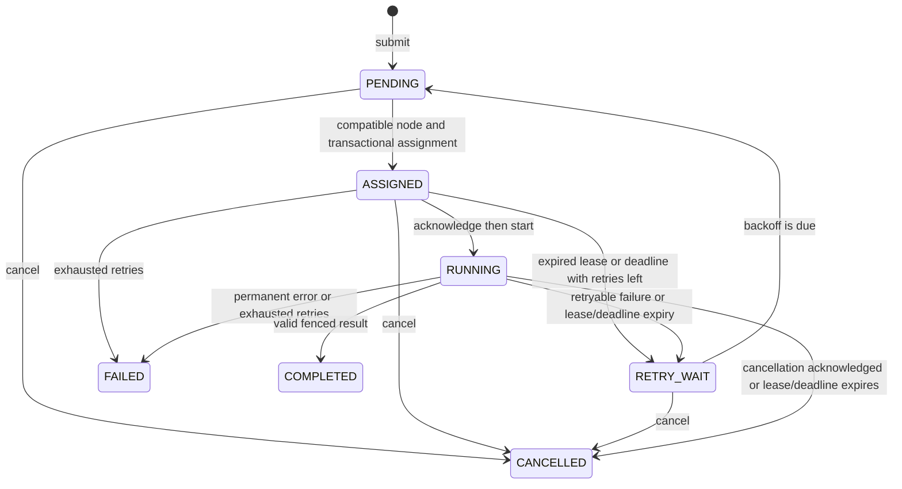

# Job API and synthetic worker protocol v1

Phase 06 reuses this state machine, locks, leases and fencing for [sequential agent workflows](agents-v1.md). Its dedicated submission/step/checkpoint routes add no second scheduler. Automatic cross-node workflow failover remains Phase 07; old synthetic assignment shapes are preserved.

This records the Phase 04 baseline. Phase 05 adds opt-in model-aware text inference through the [inference extension v1](inference-v1.md), while preserving synthetic job semantics and strict older assignment shapes. Only opted-in inference workers receive its additional payloads.

The typed source is `packages/shared-schemas/src/godfather_contracts/jobs.py`. All routes use `/api/v1`, exactly one bearer authorization header, commit-before-success transactions, and existing correlation IDs. Job/user inputs are never logged or echoed by validation errors. Use synthetic inputs only; results and inputs are visible to authorized workspace users and the assigned node.

## Administrator API

| Method and path                                | Behavior                                                                       |
| ---------------------------------------------- | ------------------------------------------------------------------------------ |
| `POST /jobs`                                   | Submit as the authenticated owner; returns 201 and a job view                  |
| `GET /jobs?limit=100&offset=0`                 | List only accessible workspace jobs, limit 1?200                               |
| `GET /jobs/{job_id}`                           | Inspect job, retry policy, assignment, fencing token and current attempt       |
| `POST /jobs/{job_id}/cancel`                   | Idempotently request cancellation; requires job owner/workspace administration |
| `GET /jobs/{job_id}/attempts`                  | Durable attempt identities, timing, fences and classified errors               |
| `GET /jobs/{job_id}/events?limit=100&offset=0` | Audit history, limit 1?500                                                     |

Only provisioned administrator credentials are supported at this phase. Missing/wrong/revoked credentials return 401; disabled/unauthorized roles return 403. An inaccessible job or workspace returns 404. Unknown fields and invalid contract values return safe 422 responses. A platform administrator does not automatically get private workspace access.

Example submission:

```json
{
  "workspace_id": "00000000-0000-0000-0000-000000000001",
  "type": "synthetic.echo",
  "requirements": {
    "capabilities": ["coding"],
    "os": "any",
    "architecture": "any",
    "cpu_count": 1,
    "ram_bytes": 0,
    "backend": "any",
    "runtimes": [],
    "models": []
  },
  "priority": 0,
  "timeout_seconds": 300,
  "retry": { "limit": 1, "backoff_seconds": 1 },
  "input": {
    "value": "synthetic",
    "steps": 3,
    "fail_until_attempt": 1,
    "permanent": false
  }
}
```

Use a provisioned workspace UUID. Priority is -100?100. Timeout is 1?86400 seconds **per attempt from assignment**, including acknowledgement time. Retry limit 0?10 means additional attempts; total attempts are at most limit + 1. Requirements also support bounded exact-label runtime/dependency/toolchain/sandbox lists (include versions in labels when required) and GPU memory. Models match runtime/identifier pairs exactly. Synthetic strings/steps are bounded to 1000 characters/100 steps; no local path, shell or arbitrary handler is accepted. `synthetic.fail` always reports a classified failure. Echo may fail through `fail_until_attempt` for deterministic retry testing.

## State machine



Cancellation of a running job durably sets `cancel_requested_at`; it retains its resource reservation until acknowledgement or expiry. A completion/failure racing a previously committed cancellation becomes `CANCELLED` and cannot publish a result. A completion committed first stays `COMPLETED`. There is no hard process-kill protocol. Completed/failed/cancelled states are immutable. No manual retry endpoint exists in this phase; bounded automatic retries are the supported policy.

Retryable codes are `transient_error`, `lease_expired` and `timeout`. `permanent_error` is final immediately. Attempt failures persist their code and retryability. Backoff is `min(3600, base_seconds * 2^(attempt_number - 1))`, with no timing randomness. On the next maintenance scan after `next_run_at`, the job becomes pending and may be assigned. Disconnection alone does not extend or immediately invalidate a lease. The lease/deadline bounds when an unresponsive attempt is fenced; a restarted coordinator catches up from PostgreSQL state. Retry restarts the synthetic handler, without restoring partial steps.

## Worker extension

Registration/heartbeat protocol v1 stays unchanged for existing workers. Assignment requires `job_protocol_version: 1` in the advertisement and `resources.source: simulated`. The command-line opt-in is `--execute-synthetic` together with `--simulate`. Advertisement allowlists `allowed_job_owner_ids` and `allowed_workspace_ids` are UUID arrays, default empty. The worker's individual identity is its owner's explicit contribution channel. Both allowlists plus workspace access are required across owners; health administrators cannot edit them.

| Method and path                                | Body and response                                                                                       |
| ---------------------------------------------- | ------------------------------------------------------------------------------------------------------- |
| `POST /workers/{node_id}/jobs/poll`            | `session_id`, `job_protocol_version` (default 1); assignment or null                                    |
| `POST /workers/{node_id}/jobs/{job_id}/report` | `session_id`, protocol, `attempt_id`, `fencing_token`, `action`; state, cancellation flag, lease expiry |

An assignment includes job data, attempt UUID, fencing token, lease expiry and absolute deadline. Repeated polls may redeliver the same unstarted assignment; they never create attempts. Acknowledge with `action: ack`, then `start`. Duplicate starts are refused. Reports support `progress` with a 0?100 integer, `renew`, `complete` with `{value, steps}`, `fail` with `transient_error`/`permanent_error`, and `cancelled` when a cancellation is pending. Progress renews the lease as well. The synthetic worker keeps heartbeats/renewals active during simulated delays.

Every report revalidates the credential, node, current process session, job assignment, attempt UUID, generation, active status, workspace/owner permission, lease and deadline. Expired/stale/terminal ownership gets 409 even if the sweep has not run. Wrong node credential scope gets 403; unsupported job protocol gets 426. A stale result never overwrites a later attempt. Reconnection with another process session does not inherit the old execution attempt. On transport failure the worker discards local progress; durable lease expiry governs retry.

The default execution lease is 30 seconds (`GODFATHER_EXECUTION_LEASE_SECONDS`, range 3?3600). Renewals use `min(now + lease_duration, attempt_deadline)`; they cannot extend the timeout. Scheduling and expiry run in the existing health maintenance loop, initially every second. `GODFATHER_SCHEDULER_ENABLED=false` pauses scheduling and execution recovery while leaving health monitoring active. The test-only `health_monitor_enabled=False` disables the combined maintenance task for explicit deterministic ticks.

## Events

Events include `job.submitted`, `job.assigned`, `job.acknowledged`, `job.started`, `job.progress`, `job.lease_renewed`, `job.lease_expired`/`job.timeout`, `job.attempt_failed`, `job.retried`, `job.completed`, `job.cancellation_requested`, and `job.cancelled`. They contain UTC timestamps, correlation IDs and node/attempt identities when applicable. Submitted/never-assigned cancellations have no attempt identity. Retry events refer to the previous attempt. Details contain safe codes, fencing tokens or numeric progress, not arbitrary worker error messages, input values, results or credentials. Node contribution changes are separately audited.

Attempt and event rows remain after terminal completion. Queued/assigned/running/retry state and all retry/fairness decisions survive API and scheduler restarts. Checkpoint references remain null for new jobs: there is no checkpoint persistence/restoration or external side-effect execution here.
